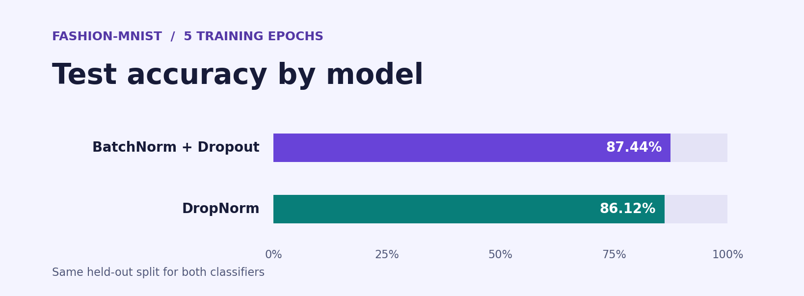

<h1 align="center">Custom PyTorch Layers</h1>

<p align="center"><strong>Two layers built with <code>torch.nn.Module</code> and a Fashion-MNIST experiment.</strong></p>

<p align="center">
  
  
  
  
</p>

I implemented **DropNorm**, a layer that combines feature masking and normalization, and **SplitLinear**, a layer that reuses the same linear transformation on two halves of its input. I evaluated DropNorm in a clothing image classifier and included a step-by-step example for SplitLinear.

## Fashion-MNIST results



I trained both classifiers for **five epochs** with Adam, cross-entropy loss, and a batch size of 64. They used the same hidden layer widths (`512 → 256`) and the same test split. In this run, the built-in layers led by **1.32 percentage points**. The two setups differ in how and where they mask and normalize features, so the comparison measures the two setups as implemented.

## How the layers work

| Layer | Forward pass |
| :--- | :--- |
| **DropNorm** | In training, selects one random feature mask shared across the batch. It computes normalization statistics for each sample over the retained features, applies learned scales and offsets, and zeros the masked positions. In evaluation mode, it uses all features, disables masking, and scales the output by `0.5`. |
| **SplitLinear** | Splits the input along the feature dimension. Both halves pass through the same linear layer and a ReLU, then are concatenated to restore the original feature width. The notebook prints the intermediate tensors from a small example. |

## Run the notebook

Open the `.ipynb` file in this repository to see the saved outputs. To run it locally, install the dependencies and start JupyterLab from the repository folder.

```bash
python -m pip install torch torchvision jupyterlab
jupyter lab
```

Run the cells in order. The first run downloads Fashion-MNIST. The last cell evaluates both trained models and prints their test accuracy.

---

*Developed as part of the Deep Learning course at the Open University of Israel.*
